# 역사자료 연구실 v3.1 — 디자인 개선

v3 실행파일(`역사자료연구실-v3.exe`)의 **기능은 그대로 두고 화면만 다시 디자인**한 버전입니다.
디자인 시안: [Claude Design 캔버스 「역사자료 연구실 v3.1 리디자인」](https://claude.ai/artifact/SNRQfUW6gRB6Epwk5fe5PU) (통합 검색 · 자료원 연결 · 내 문헌 · 문헌 결과 4개 화면).

| 변경 전 (v3) | 변경 후 (v3.1) |
|---|---|
| 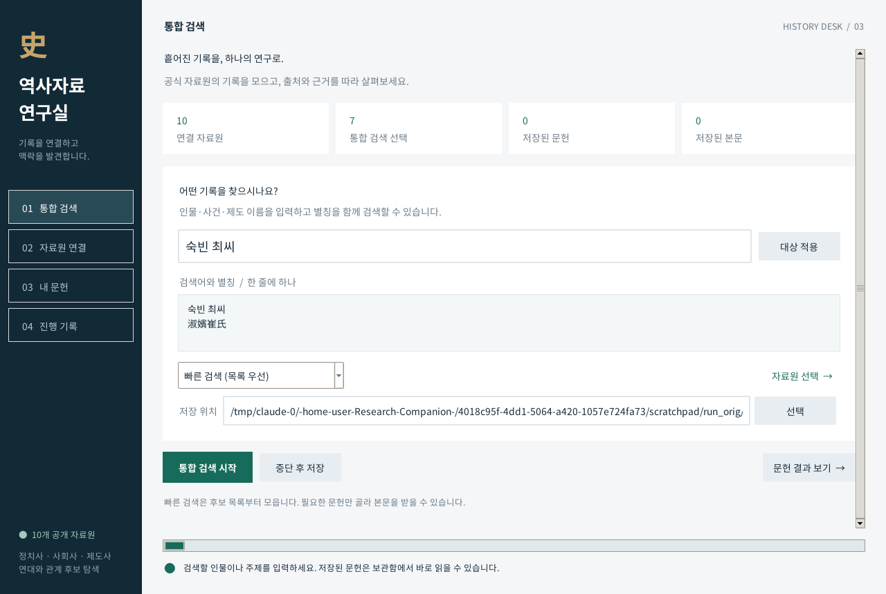 | 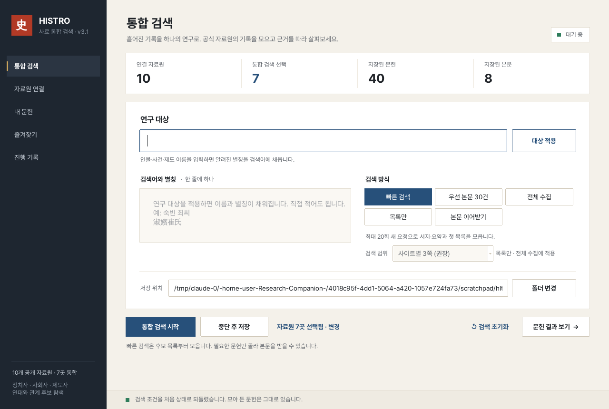 |
| 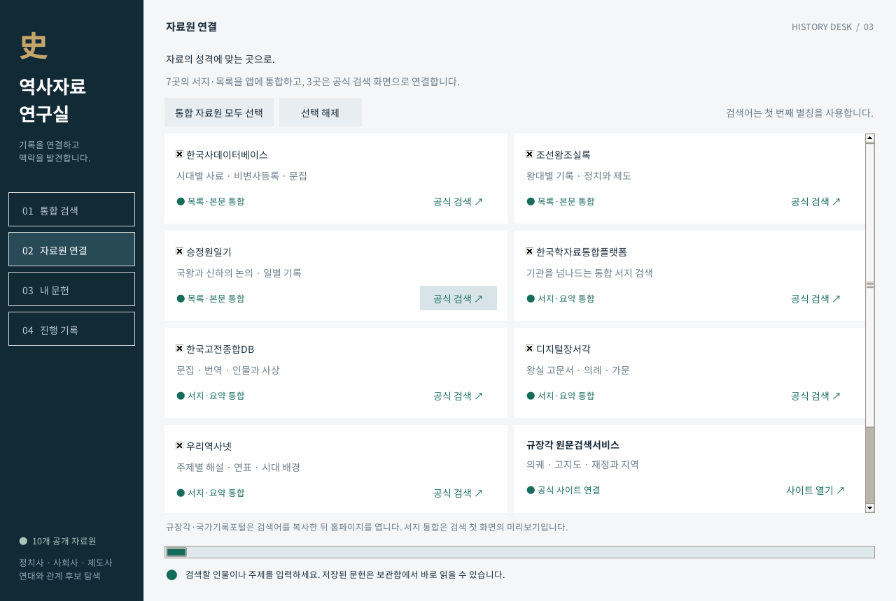 | 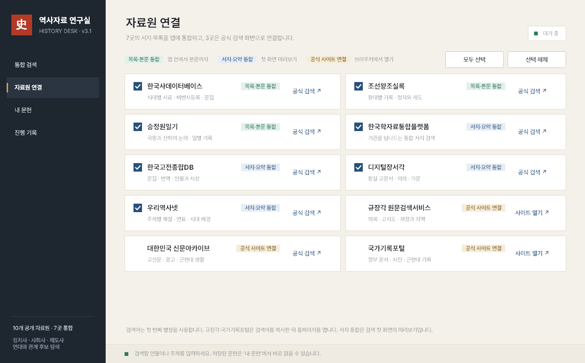 |
| 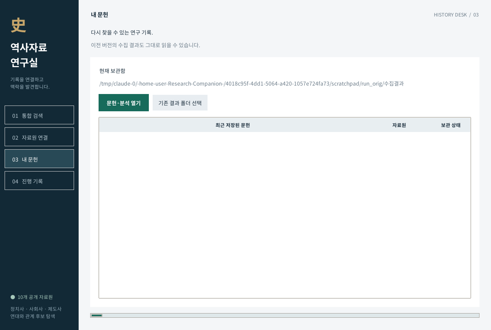 | 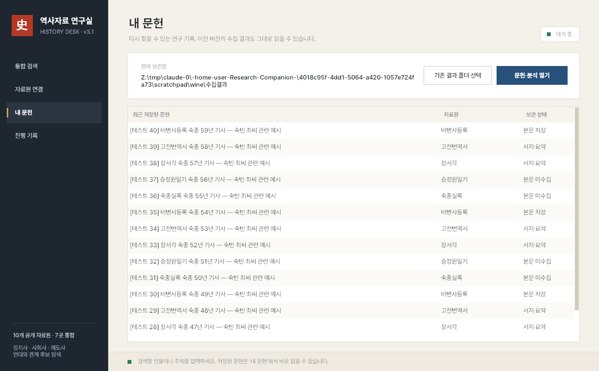 |

결과 창과 관계 지도: [after-results.png](docs/screenshots/after-results.png), [after-relations.png](docs/screenshots/after-relations.png)

## 무엇이 바뀌었나

**디자인 방향** — 한지 바탕(#F4F1EA), 먹색 사이드바(#1E2630), 쪽빛 강조(#27507A), 낙관(붉은 도장) 로고.

- **글꼴**: Pretendard(SIL OFL 1.1)를 EXE에 내장했습니다. 맑은 고딕이 없는 PC에서도 같은 모양으로 보입니다.
- **고해상도 화면**: Windows 배율 125%·150%에서 글자가 흐릿하던 문제를 고쳤습니다(DPI 인식 + 여백 자동 배율). 창 크기도 화면에 맞춰 줄어듭니다.
- **제목·숫자 크기 버그 수정**: v3은 전역 글꼴 설정 때문에 큰 제목(23pt)과 통계 숫자가 실제로는 10pt로 보였습니다. 이제 의도한 크기로 나옵니다.
- **사이드바**: 금색 표시선이 있는 메뉴, 마우스를 올리면 강조, 붉은 도장 로고.
- **페이지 머리말**: 화면 제목(큰 글씨) + 한 줄 설명 + 오른쪽 상태 표시(대기 중 / 수집 중).
- **통합 검색**: 통계 4칸을 한 카드로 묶음, 연구 대상 입력칸 확대(Enter로 대상 적용), 검색 방식을 드롭다운 대신 **세그먼트 버튼 5개**로 바꾸고 방식별 설명을 바로 아래에 표시, "자료원 7곳 선택됨 · 변경" 링크.
- **진행 막대**: 쉬는 동안 화면에 고정돼 있던 초록 막대를 없애고, 수집 중일 때만 하단 상태 표시줄에 나타납니다.
- **자료원 연결**: 체크박스를 ✕ 대신 ✓로 직접 그림, 범위 배지(목록·본문 / 서지·요약 / 공식 사이트)를 색으로 구분하고 상단에 범례 추가.
- **내 문헌**: 보관함 정보와 버튼을 한 줄로, 줄무늬 표, 문헌이 없을 때 안내 문구.
- **문헌 결과 창**: 목록과 본문을 **좌우 나란히** 배치(기존 위·아래), 본문 영역에 점수·관점·연대·상태 배지와 제목·메타·근거·본문을 서식으로 구분.
- **관계 후보 지도**: 창 폭에 맞춰 중앙 정렬, 선택한 연결을 쪽빛으로 강조, 연결을 클릭하면 근거 표시.
- **한글 입력**: 입력 중(조합 중)인 글자가 작게 보였다가 커지던 현상을 고쳤습니다. 입력칸에 들어갈 때 IME 조합 글꼴을 그 칸의 글꼴·크기로 맞춥니다.
- **뒤로가기**: 메인 창 제목 옆 `← 이전 화면`(Alt+←), 결과 창 `← 연구실로`·관계 지도 `← 결과로`(Esc).
- 화살표 없는 얇은 스크롤바, 1px 테두리 버튼, 포커스 시 쪽빛 테두리.

**바뀌지 않은 것** — 수집기(`collector`), 자료원 연결(`source_connectors`), 분석(`analysis_engine`), 브라우저 연결(`browser_links`)은 원본 EXE의 코드를 바이트 그대로 사용합니다. 수집 결과 폴더 형식도 같아서 기존 결과를 그대로 읽습니다.

## 버그 수정·최적화 (v3.1 보완)

- **결과 창 여는 속도**: 문헌 5,000건 기준 9초 → 1.3초. 분석 엔진이 같은 별칭·본문을 수백만 번 다시 정리하던 부분에 결과 재사용(캐시)을 넣었습니다. 5,000건 전수 비교로 분석 결과가 원본과 같음을 확인했습니다. 수집 중 점수 계산도 같이 빨라집니다.
- **수집 중 창 닫기**: 전에는 수집 중에 X를 눌러도 창이 닫히지 않았습니다. 이제 "저장하고 닫을까요?"를 묻고, 현재 요청이 끝나 저장되면 자동으로 닫힙니다.
- **결과 창 중복**: '문헌 결과 보기'를 여러 번 누르면 같은 창이 계속 새로 열리던 것을, 이미 열린 창을 앞으로 가져오도록 바꿨습니다.
- **결과 창 자동 갱신**: 결과 창에서 '선택 문헌 본문 받기'를 한 뒤, 수집이 끝나면 열린 결과 창에 받은 본문이 바로 반영됩니다.
- **선택 유지**: 새로고침·필터를 바꿔도 보고 있던 문헌 선택이 유지됩니다(전에는 항상 첫 줄로 돌아감).
- **진행 기록**: 로그를 한 번에 묶어 표시하고 최근 4,000줄만 남겨, 오래 수집해도 느려지지 않습니다. 위로 올려 읽는 중에는 자동으로 맨 아래로 끌어내리지 않습니다.
- **안정성**: report.json이 깨져 있거나 제목 없는 기록이 있어도 화면 갱신이 멈추지 않습니다. 중단 파일을 쓸 수 없을 때 오류를 알려줍니다.
- **작은 편의**: '원문 주소 복사' 후 "복사됨 ✓" 표시, 결과 창 검색칸에서 Esc는 검색어를 먼저 지움, 대화상자가 창 뒤로 숨지 않게 부모 창 지정, 새 창을 열 때 테마를 다시 만들지 않음.

## 판정 학습 추천 (학습 기반 순위 + 능동 학습)

규칙 점수는 그대로 두고, **연구자의 "관련 있음 / 없음" 판정을 학습해 순위를 다시 매기는 층**을 얹었습니다.

- **판정**: 결과 창 오른쪽 위 `✓ 관련 있음` / `✕ 관련 없음` 버튼, 또는 목록에서 키 `1` / `0` (지우기: `Delete`). 판정하면 다음 문헌으로 넘어갑니다.
- **학습 추천순**: 관련·무관을 각각 3건 이상 판정하면 '추천'(0–100) 열이 생기고 그 순서로 정렬됩니다. 판정할 때마다 바로 다시 학습합니다(0.01초).
- **판정 필요순(능동 학습)**: 모델이 가장 헷갈리는(추천 50 근처) 미판정 문헌부터 보여주고, 판정 후 다음으로 헷갈리는 문헌으로 이동합니다. 학습 전에는 자료집을 번갈아 보여줍니다. 적은 판정으로 빨리 정확해집니다.
- **추천 근거**: 문헌마다 어떤 특징이 추천을 올리고 내렸는지(+/− 가중치) 표시합니다.
- **추천 성능 창**: 판정한 문헌 안에서 규칙 점수와 학습 추천을 Precision@5/10/20, AUC로 비교합니다. 학습 추천은 층화 k-겹 교차검증 값(각 문헌을 그 판정을 보지 않은 모델로 채점)이라 과대평가되지 않습니다. 학습된 가중치 상위 항목도 보여줍니다.
- **저장**: 결과 폴더의 `judgments.json`, `judgments.csv`(엑셀로 열림)에 대상 인물별로 남습니다.

특징: 규칙 점수와 근거(걸린 규칙·별칭), 관점, 자료집, 수집 상태, 본문/요약 여부, 연대, 공동 등장한 말, 찾은 검색어, 제목·요약·본문 앞부분 낱말. 모델: 클래스 균형을 맞춘 L2 로지스틱 회귀(파이썬 표준 기능만 사용, `src/ranker.py`).

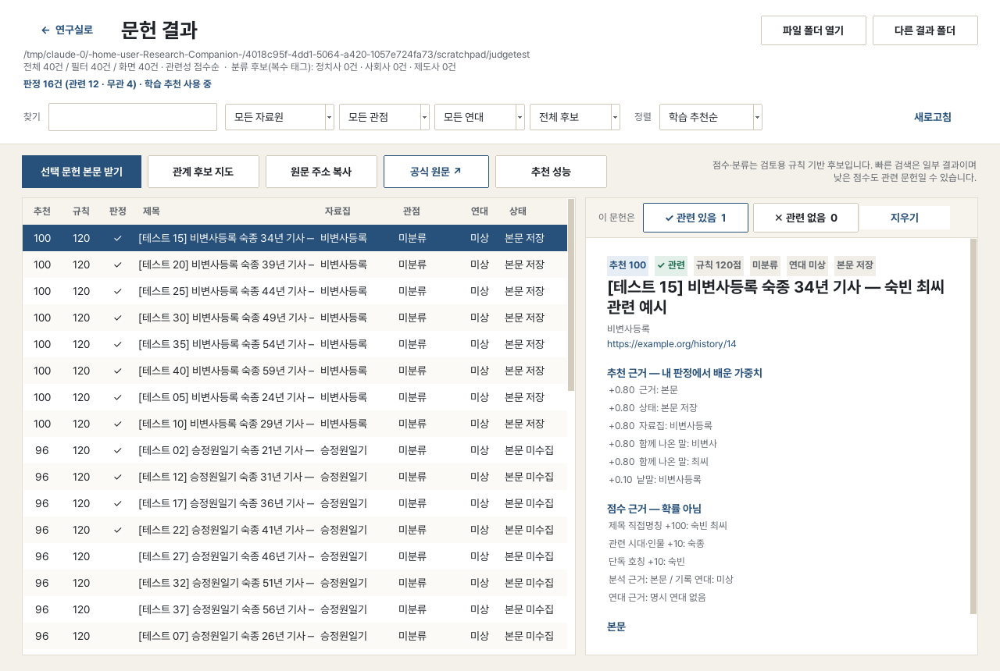
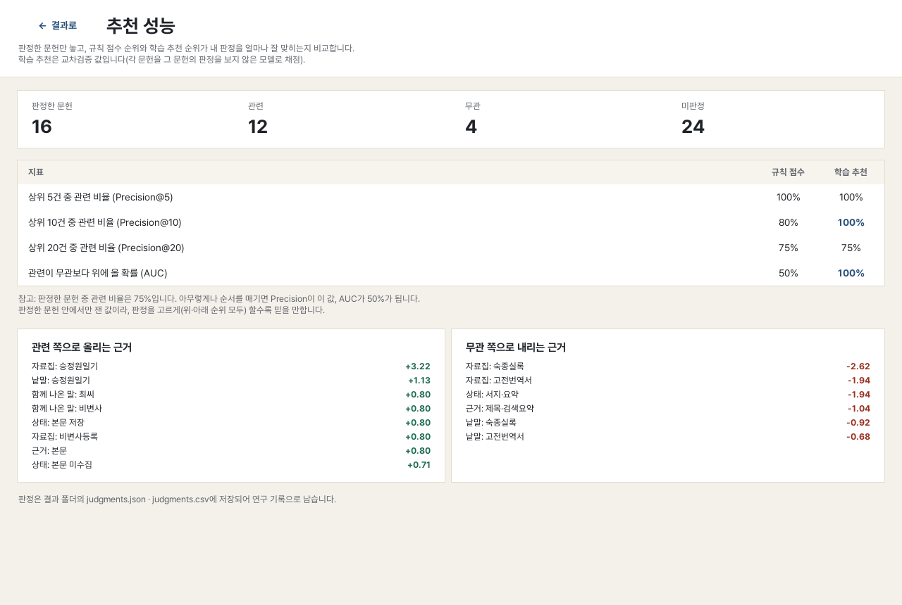

## 텍스트 분석 (강의 2~6강 기술 적용)

결과 창의 **텍스트 분석** 버튼(또는 **비슷한 문헌**)으로 엽니다. 모두 인터넷 없이, 파이썬 표준 기능만으로 동작합니다(`src/textlab.py`, `src/textlab_ui.py`).

| 강의 | 기술 | 앱 기능 | 구현 |
|---|---|---|---|
| 2강 Sparse | BoW, TF-IDF, 코사인 | **유사도 검색 · 비슷한 문헌** | 한글은 조사·어미를 떼고, 띄어쓰기 없는 한문은 두 글자씩 잘라 BoW → 서브리니어 TF-IDF → 역색인 코사인. 겹치는 핵심어 표시 |
| 3강 Dense static | PMI, SVD, Skip-gram | **어휘 관계(시대별)** | 4어절 창 공기 행렬 → PPMI(문맥 분포 0.75제곱 평활) → 부분공간 반복법 절단 SVD 32차원. 시대(세기)별 PPMI 연관어 |
| 4강 Contextual | 문맥 표현 | **문맥 용례** | 용어가 나온 자리마다 앞뒤 문맥 TF-IDF 벡터 → k-평균(군집 수는 실루엣으로 선택) → 쓰임새별 용례(KWIC) |
| 5강 Classification | 다중 라벨 분류 | **주제 분류** | 라벨별 로지스틱 회귀(one-vs-rest), TF-IDF 특징, 주제 추가 가능 |
| 6강 Semi-supervised | 의사라벨 | **적은 주석으로 전체 분류** | 규칙 관점 = 약한 라벨, 연구자 주석 = 강한 라벨 → 학습 → 확신 높은 미주석 문헌에 의사라벨 → 재학습. 약한 음성에 섞인 양성은 PU 보정(Elkan–Noto), 주석으로 라벨별 기준선 조정 |

**넣지 않은 것**: BERT 등 사전학습 트랜스포머(4강)와 그 미세조정(5강). 모델 파일만 수백 MB이고 GPU·인터넷이 필요해 오프라인 단일 EXE에 맞지 않습니다. 4강은 문맥 벡터 군집으로 근사했습니다.

**검증(가상 사료 1,500건, 주제의 절반은 규칙 키워드 없이 서술)** — `tools/make_test_corpus.py`

| 주석 수 | 규칙 관점 F1 | 준지도 분류 F1 | 의사라벨 없이 |
|---|---|---|---|
| 0 | 0.769 | 0.779 | 0.777 |
| 10 | 0.769 | 0.784 | 0.782 |
| 40 | 0.769 | **0.871** | 0.867 |
| 100 | 0.769 | **0.883** | 0.888 |

앱 안 교차검증(주석 40건): 마이크로 F1 규칙 0.71 → 모델 0.86, 제도사 0.52 → 0.87. 이득은 주로 약한 라벨 + 주석 + PU 보정에서 나오고, 의사라벨 단계의 추가 이득은 이 시험에서 ±0.01 수준이었습니다.
속도(5,000건): TF-IDF 색인 1.3초, 검색 1ms, 어휘 관계 약 3초(백그라운드), 주제 학습 1,500건 약 3초(백그라운드).

주석·예측은 결과 폴더 `topic_labels.json/csv`, `topic_predictions.csv`에 저장됩니다.

| | |
|---|---|
| 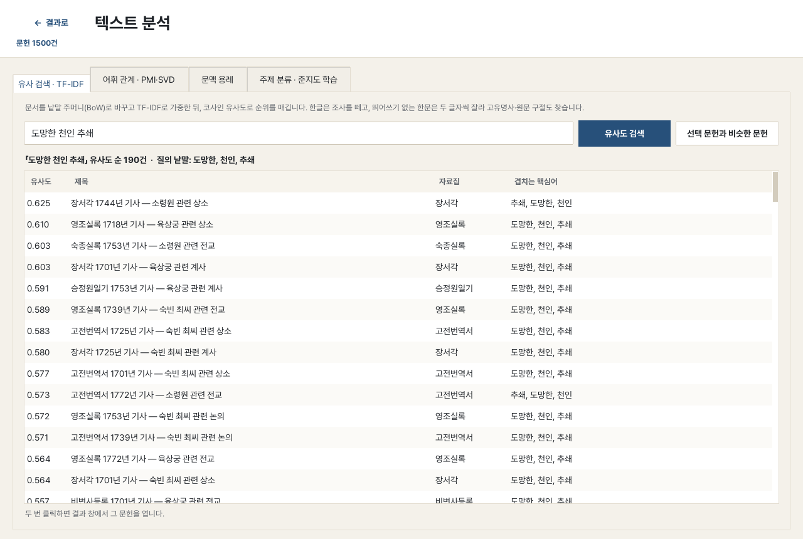 | 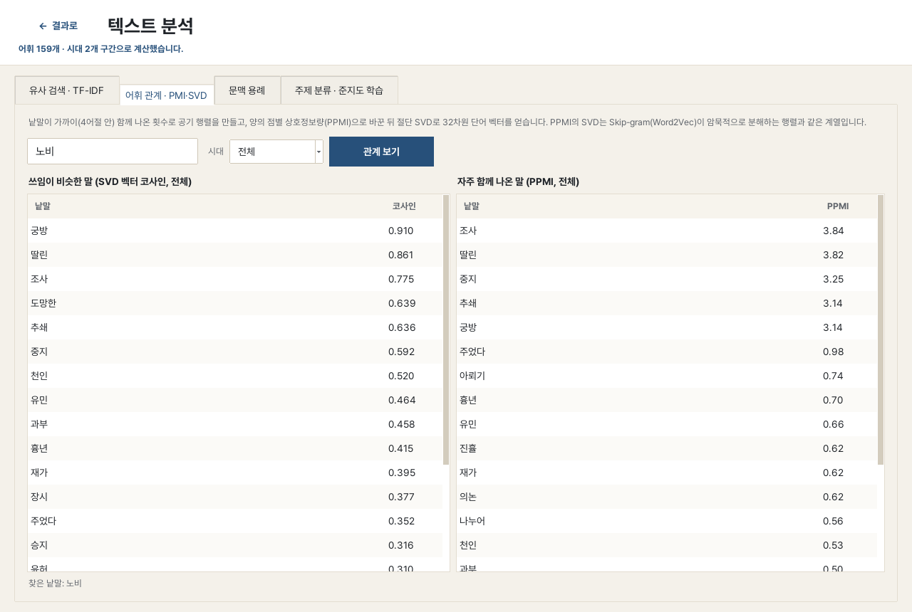 |
| 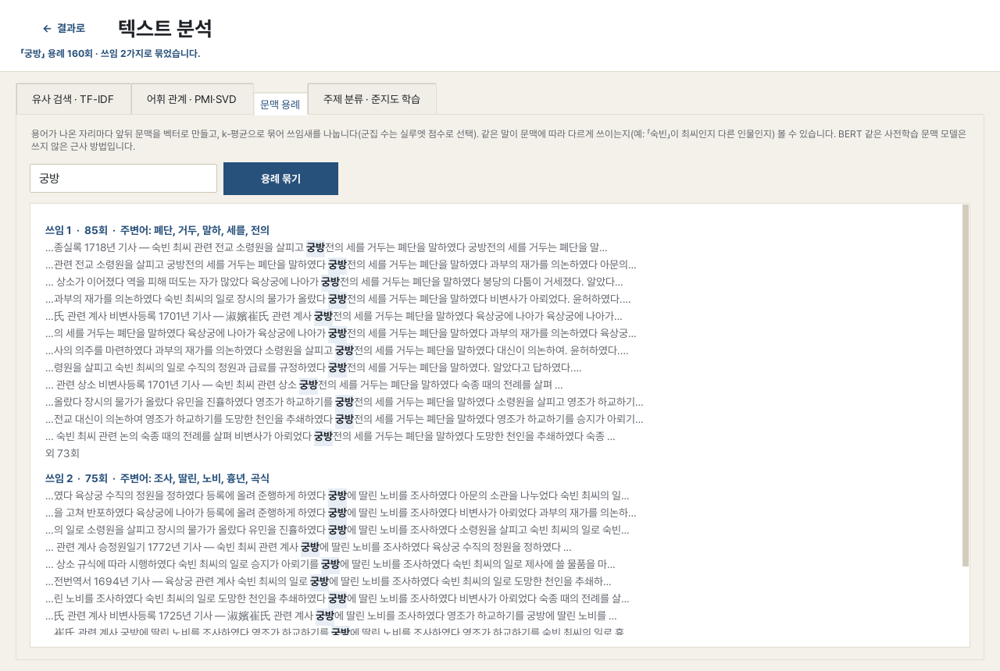 | 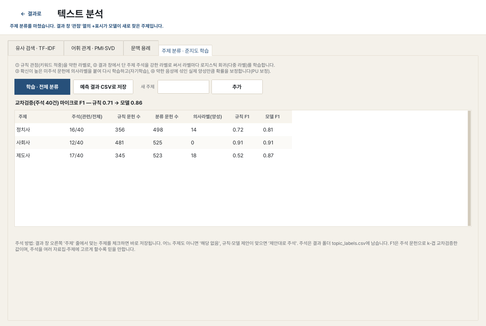 |

## 폴더

```
src/app.py             메인 창 (원본 바이트코드에서 로직을 복원한 뒤 화면만 새로 구성)
src/result_viewer.py   문헌 결과 창 · 관계 후보 지도 (동일)
src/ui_theme.py        색상·글꼴·스타일과 화면 조립 도우미
src/ranker.py          판정 저장 · 특징 추출 · 학습 추천 · 교차검증 평가
src/textlab.py         TF-IDF · PMI/SVD · 문맥 군집 · 다중 라벨 준지도 분류
src/textlab_ui.py      텍스트 분석 창
src/fonts/             Pretendard Regular/SemiBold/Bold + OFL 라이선스
tools/repack.py        원본 EXE에 새 모듈·글꼴을 넣어 v3.1 EXE를 만드는 스크립트
tools/carchive.py      PyInstaller 아카이브 읽기 도우미
docs/screenshots/      변경 전후 화면
```

## EXE 만들기

원본 v3 EXE의 PyInstaller 아카이브에서 `app`, `ui_theme`, `result_viewer`를 교체하고 `ranker`·`textlab`·`textlab_ui`(새 모듈), `tkinter.font`(v3에는 없던 표준 모듈)와 글꼴을 추가합니다. 나머지 1,000여 개 항목은 바이트 그대로 복사합니다. **Python 3.10**으로 실행해야 합니다(EXE에 든 python310.dll과 바이트코드 버전이 같아야 함).

```bash
python3.10 tools/repack.py 역사자료연구실-v3.exe src 역사자료연구실-v3.1.exe
```

또는 Windows에서 PyInstaller로 원래 프로젝트를 다시 빌드할 때는 `src/`의 세 파일로 교체하고, `--add-data "fonts;fonts"`를 추가하면 됩니다.

## 확인한 것

- 원본 앱의 자체 점검(`--smoke-test`)을 원본 EXE와 새 EXE에서 **Wine(Windows 실행 환경)으로 실제 실행**해 결과를 비교: 자료원 수, 통합 자료원 수, 화면 4개, 수집 실행·종료 메시지, 결과 창, 관계 지도 항목이 모두 동일.
- 테스트용 결과 폴더(가짜 문헌 40건)로 결과 창의 목록 내용·필터(관점/검색어/자료원/점수)·관계 연결 수를 원본과 비교: 모두 동일.
- 재패킹 도구 검증: 아무것도 바꾸지 않고 재패킹하면 원본과 내용이 같은 EXE가 나옴(직렬화 플래그 1바이트 차이만 있음).

## 주의

- 실제 Windows PC가 아니라 Wine에서 확인했습니다. 첫 실행 시 SmartScreen 경고가 뜰 수 있는 것은 원본과 같습니다(서명 없음).
- Pretendard에는 한자가 없어서 한자는 Windows가 다른 글꼴로 자동 대체해 표시합니다.
- 원본에 함께 있던 `상세사용법.md`의 소스 실행 예(`collector.py`)는 이 폴더에 없는 원본 소스를 기준으로 합니다.

| 파일 | SHA-256 |
|---|---|
| 역사자료연구실-v3.exe (원본) | `f6f46bcaa4f0efd834781cf6778ffe565752fd42320850f34a6c745fe28a0086` |
| 역사자료연구실-v3.1.exe | `ef849b79768e129d1a130a764de046f954db8369780ec364de39d32dc67228e2` |
