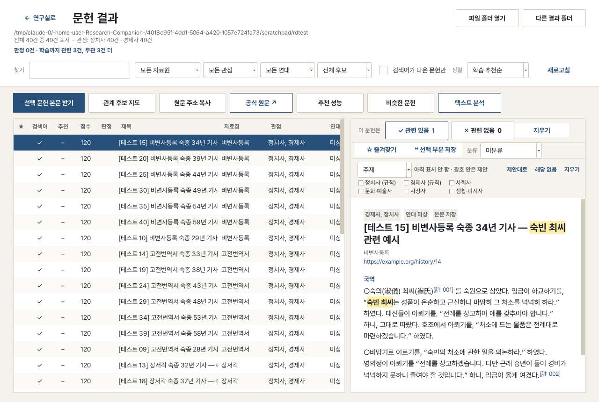
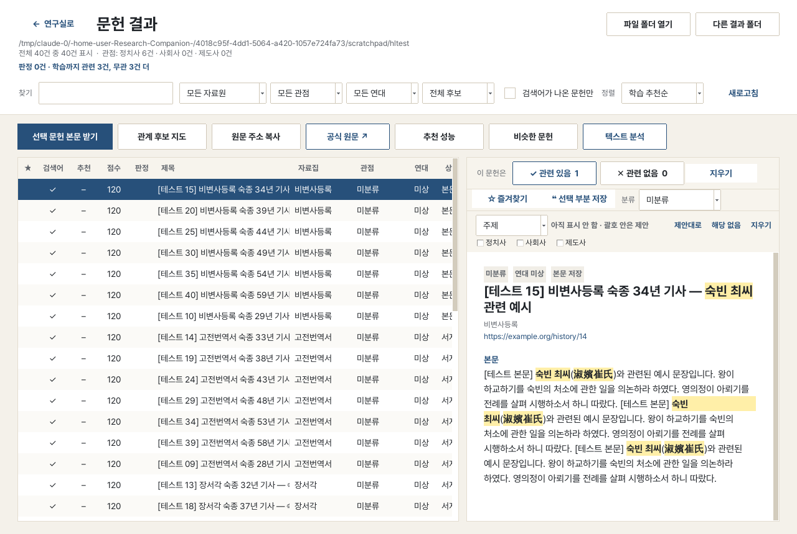
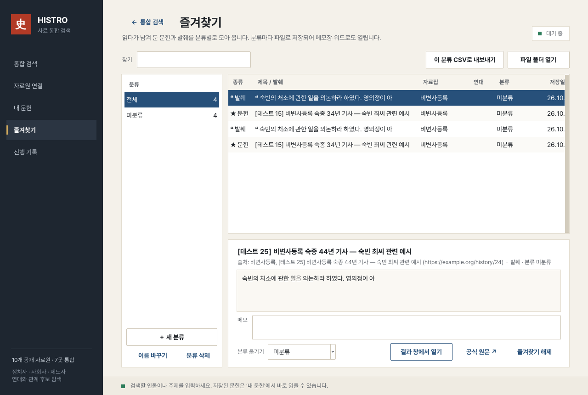
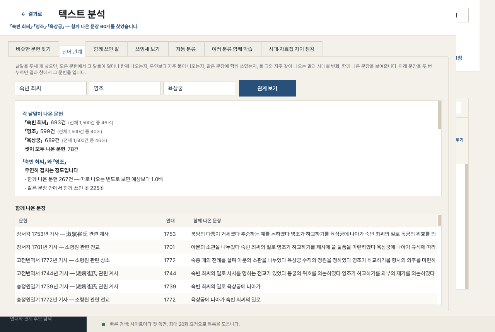

# HISTRO

**HISTRO**는 조선시대 사료를 여러 공식 데이터베이스에서 한 번에 찾아 모으고, 앱 안에서 읽고 분류·분석하는 Windows 프로그램입니다.
인물·사건·제도 이름을 넣으면 관련 기록을 모아 관련성 순으로 보여주고, 연구자의 판단을 학습해 점점 더 맞는 자료를 앞으로 올려 줍니다.


## 내려받기와 실행

1. [release/HISTRO.zip](release/HISTRO.zip)을 내려받습니다(파일 화면 오른쪽 위 ↓ 버튼).
2. 압축을 풀고 `HISTRO.exe`를 원하는 폴더(예: 바탕화면의 새 폴더)에 둡니다.
3. 더블클릭해 실행합니다. 처음에 "Windows의 PC 보호" 창이 뜨면 **추가 정보 → 실행**을 누릅니다.

- Windows 10/11 64비트. Python 등 다른 설치는 필요 없습니다.
- 검색에는 인터넷이 필요하고, 저장된 자료를 읽고 분석하는 것은 인터넷 없이 됩니다.
- 모은 자료는 exe 옆 `수집결과` 폴더에 저장됩니다. 새 버전으로 바꿀 때 exe만 바꾸고 이 폴더는 그대로 두세요.

## 주요 기능

| 기능 | 하는 일 |
|---|---|
| **통합 검색** | 한 번 검색으로 7개 사료 데이터베이스의 결과를 모읍니다 |
| **자료원 연결** | 검색할 사이트를 고르고, 자동 수집이 안 되는 사이트는 공식 검색 화면을 바로 엽니다 |
| **문헌 결과 보기** | 모은 문헌을 앱 안에서 읽고, 점수·자료원·관점·연대로 거릅니다 |
| **관련/무관 판정 학습** | 연구자가 표시한 판정을 학습해 관련 문헌을 위로 올립니다 |
| **즐겨찾기** | 문헌 통째 또는 본문 일부를 별표로 저장하고, 직접 만든 분류(폴더)로 정리합니다. 분류마다 파일로 저장됩니다 |
| **비슷한 문헌 찾기** | 고유명사·원문 구절로 찾거나, 지금 보는 문헌과 내용이 닮은 문헌을 찾습니다 |
| **단어 관계** | 낱말 두세 개가 얼마나 함께 나오는지, 우연보다 자주 붙어 나오는지, 시대별로 어떻게 달라지는지 보고 함께 나온 문장을 확인합니다 |
| **함께 쓰인 말** | 어떤 낱말과 자주 함께 나온 말, 비슷한 맥락에서 쓰인 말을 시대별로 봅니다 |
| **쓰임새 보기** | 한 낱말이 나온 문장들을 쓰임새별로 묶어 보여줍니다 |
| **자동 분류** | 몇십 건만 표시해 두면 나머지 문헌 전체를 정치사·경제사·사회사·문화·예술사·사상사·생활·미시사로 분류합니다 |
| **여러 분류 함께 학습** | 주제·자료 유형·직접 만든 분류(예: 정치적 입장)를 함께 배울 때와 따로 배울 때 중 어느 쪽이 정확한지 비교합니다 |
| **시대·자료집 차이 점검** | 다른 시대·자료집으로 배운 자동 분류가 덜 맞는지 점검하고, 보완한 결과와 비교합니다 |
| **관계 후보 지도** | 같은 문장에 함께 나온 인물·기관을 연결해 보여줍니다 |

모든 점수와 분류는 연구자가 검토해야 하는 **후보**입니다. 판단 근거를 화면에 함께 보여줍니다.

## 사용 방법

### 1. 검색하기 — 통합 검색

1. **연구 대상**에 인물·사건·제도 이름을 넣고 **대상 적용**(또는 Enter)을 누릅니다. 검색어 칸에 이름이 채워집니다(숙빈 최씨처럼 미리 등록된 인물은 별칭까지). 연구 대상을 비워 두면 첫 검색어를 대상으로 씁니다.
2. **검색어와 별칭** 칸에서 검색어를 고치거나 더합니다. 한 줄에 하나씩 적습니다.
3. **검색 방식**을 고릅니다.

| 검색 방식 | 하는 일 |
|---|---|
| 빠른 검색 (기본) | 목록·서지·요약만 모읍니다. 최대 20번 요청하는 빠른 예비 검색 |
| 목록만 | 본문 없이 목록만 모읍니다 |
| 우선 본문 30건 | 저장된 목록에서 60점 이상 문헌의 본문을 점수순으로 최대 30건 받습니다 |
| 전체 수집 | 찾은 후보의 본문을 모두 받습니다. 오래 걸립니다 |
| 본문 이어받기 | 아직 받지 않은 본문을 이어서 받습니다 |

4. '목록만'·'전체 수집'은 **검색 범위**(사이트별로 볼 쪽 수: 1·3·5·10쪽·끝까지, 기본 3쪽)를 고릅니다. 범위가 넓을수록 관련 없는 결과도 많아지니 좁게 시작하세요.
5. **통합 검색 시작**을 누릅니다. 진행 상황은 아래 상태 표시줄과 **진행 기록** 화면에 나옵니다.
6. 멈추려면 **중단 후 저장**을 누릅니다. 지금까지 받은 내용은 저장되고, 같은 폴더로 다시 실행하면 이어집니다.

**↺ 검색 초기화**: 연구 대상과 검색어를 비웁니다. 다음 검색은 새 폴더에 저장되고, 이전 결과는 지워지지 않고 그대로 보관됩니다. 검색 방식·범위·자료원 선택은 그대로 둡니다.

**설정 기억**: 마지막으로 고른 검색 방식, 검색 범위, 자료원 선택(공식 사이트 포함), 저장 위치, 결과 창의 정렬·점수 거르기·검색어가 나온 문헌만·원문/주석 펼침·즐겨찾기 분류를 기억해 다음 실행 때 그대로 씁니다. exe 옆 `HISTRO 설정.json`에 저장되며, 이 파일을 지우면 처음 설정으로 돌아갑니다. 연구 대상과 검색어는 기억하지 않습니다.

**검색마다 따로 저장**: 검색어가 바뀌면 결과가 `수집결과\<대상> <날짜 시각>` 새 폴더에 저장되어 이전 검색 결과와 섞이지 않습니다. 같은 대상·같은 검색어로 다시 검색하면 그 폴더에 이어서 저장합니다. 이전 결과는 결과 창의 **다른 결과 폴더**로 열 수 있습니다.

추천 순서: **빠른 검색**으로 후보 목록을 먼저 모은 다음, 결과 창에서 필요한 문헌만 골라 본문을 받습니다.

### 2. 검색할 사이트 고르기 — 자료원 연결

| 사이트 | 앱에서 받는 내용 |
|---|---|
| 한국사데이터베이스 · 조선왕조실록 · 승정원일기 | 검색 목록과 **본문** |
| 한국학자료통합플랫폼 · 한국고전종합DB · 디지털장서각 · 우리역사넷 | 검색 첫 화면의 **제목·서지·요약** |
| 규장각 원문검색서비스 · 대한민국 신문아카이브 · 국가기록포털 | 자동 수집 안 함. **체크해 두면 통합 검색을 시작할 때 그 사이트 검색 화면을 브라우저로 함께 엽니다**(기본은 꺼짐). 카드의 **공식 검색 ↗ / 사이트 열기 ↗**로 따로 열 수도 있습니다. 검색어는 클립보드에 복사되며, 규장각·국가기록포털은 홈페이지가 열리니 검색창에 붙여넣으세요 |

체크한 사이트만 통합 검색에 씁니다. 공식 사이트만 체크하고 검색하면 앱 수집 없이 그 사이트들만 엽니다. 서지·요약만 오는 자료의 원문은 결과 창의 **공식 원문 ↗**으로 확인합니다.

### 3. 모은 문헌 읽기 — 문헌 결과 창

**문헌 결과 보기**(또는 **내 문헌 → 문헌·분석 열기**)로 엽니다. 왼쪽은 목록, 오른쪽은 본문입니다.

- **거르기**: 찾기 칸(제목·본문 검색), 자료원, 관점(아래 여섯 분류), 연대, 점수(60점·80점 이상).
- **역사 분류(관점)**: 문헌에 나오는 낱말로 여섯 분류 후보를 붙입니다. 한 문헌이 여러 분류에 들 수 있고, 직접 표시하면 그 표시를 따릅니다.

  | 분류 | 다루는 것 |
  |---|---|
  | 정치사 | 국가의 성립, 제도, 정당, 전쟁, 외교 |
  | 경제사 | 생산, 유통, 토지 제도, 화폐, 경제 구조 |
  | 사회사 | 신분 제도, 가족 형태, 계급 갈등, 사회 운동 |
  | 문화·예술사 | 종교, 미술, 음악, 건축, 의례 등 문화와 정신세계 |
  | 사상사 | 시대별 주요 사상, 이념, 종교적 교리의 흐름 |
  | 생활·미시사 | 일반 사람들의 일상생활과 삶의 방식 |

  예전 결과 폴더도 열면 새 분류로 보입니다. 예전에 '제도사'로 표시한 문헌은 정치사로 옮겨집니다.
- **정렬**: 학습 추천순 / 기본 점수순 / 판정 필요순.
- **선택 문헌 본문 받기**: 목록에서 고른 문헌(여러 개 가능)의 본문만 받습니다. 끝나면 창이 자동으로 새로고침됩니다.
- **원문 주소 복사**, **공식 원문 ↗**: 공식 사이트의 원문 주소를 복사하거나 엽니다.
- 오른쪽 본문 위에 추천·관점·연대·상태가 표시됩니다. 제목 아래 **사이트 주소(밑줄)를 누르면** 브라우저로 원문이 열립니다.
- **읽기 좋은 본문**: 본문은 사이트의 문단대로 나누어 보여 줍니다(받아 둔 원문 페이지를 다시 읽음, 없으면 '○'와 문장 끝 기준). 국역이 있는 문헌의 **원문(한문)** 과 **주석(낱말 풀이)** 은 아래에 접혀 있고 눌러서 펼칩니다. 본문 속 작은 [註 001]을 누르면 해당 풀이로 바로 갑니다. 화면 표시만 바뀌고 저장된 본문·분석은 그대로입니다.

  
- **본문 펼치기**: 본문을 아직 받지 않은 문헌은 오른쪽에 검색 화면의 짧은 글(요약)만 문단을 나눠 보여 줍니다. 그 아래 **▼ 본문 펼치기**(또는 Enter)를 누르면 본문 전체를 원문 사이트에서 받아 그 자리에 펼칩니다. 검색 조건은 그대로입니다.
- **검색어 표시**: 검색에 쓴 말(띄어쓰기 달라도 찾음)이 제목·본문에 나온 자리는 **굵은 글씨와 노란 바탕**으로 표시됩니다. 목록의 **검색어** 열 ✓는 그 문헌에 검색어가 실제로 나온다는 뜻입니다. **검색어가 나온 문헌만**을 켜면 검색어가 없는 문헌(관련 없이 끌려온 결과)을 숨깁니다.
- 목록 맨 앞 **★** 열: ★ 즐겨찾기한 문헌, ❝ 일부를 저장한 문헌.



### 4. 관련 문헌을 위로 — 판정 학습

1. 정렬을 **판정 필요순**으로 바꿉니다. 판단이 가장 애매한 문헌부터 나옵니다.
2. 문헌을 읽고 키보드 **1**(관련 있음) 또는 **0**(관련 없음)을 누릅니다. 오른쪽 위 버튼을 눌러도 됩니다. 판정하면 다음 문헌으로 넘어갑니다. 잘못 눌렀으면 **Delete**.
3. 관련·무관을 각각 3건 이상 판정하면 **추천**(0~100) 열이 생기고, **학습 추천순**으로 정렬할 수 있습니다. 판정할수록 정확해집니다.
4. **추천 성능** 버튼: 내 판정을 기준으로 기본 점수 순서와 학습 추천 순서 중 어느 쪽이 더 잘 맞히는지 보여줍니다.


### 5. 주제·자료 유형 표시하기

결과 창 오른쪽 **표시 줄**에서 합니다. 자동 분류가 이 표시를 보고 배웁니다.

1. 맨 앞 선택칸에서 분류를 고릅니다: **주제** / **자료 유형** / 직접 만든 분류.
2. 맞는 항목을 체크하면 바로 저장됩니다. 괄호 안은 앱의 제안입니다.
   - **제안대로**: 제안을 그대로 저장
   - **해당 없음**: 어느 항목도 아님
   - **지우기**: 표시 삭제
3. 표시한 문헌은 목록의 관점 열에 ✎ 가 붙습니다.

### 6. 즐겨찾기 — 원하는 부분 모아 두기

**저장하기** (문헌 결과 창)
- **문헌 통째**: 목록에서 고르고 **☆ 즐겨찾기** 버튼 또는 키보드 **F**. 다시 누르면 해제됩니다.
- **본문 일부**: 오른쪽 본문에서 필요한 부분을 마우스로 끌어 선택한 뒤 **❝ 선택 부분 저장** 또는 **Ctrl+S**. 저장한 부분은 본문에서 노랗게 표시됩니다.
- 저장할 **분류**를 버튼 옆 선택칸에서 고릅니다(처음엔 '미분류'). '＋ 새 분류…'로 바로 만들 수 있습니다.
- 마우스 오른쪽 버튼 메뉴로도 원하는 분류에 바로 저장할 수 있습니다.

**정리하기** (왼쪽 메뉴 **즐겨찾기**)
- 왼쪽에서 분류를 고르면 그 안의 문헌·발췌가 나옵니다. **＋ 새 분류**, **이름 바꾸기**, **분류 삭제**(안의 항목은 '미분류'로 옮겨짐).
- 항목을 고르고 **분류 옮기기**로 다른 분류로 보냅니다. 여러 개를 한꺼번에 골라도 됩니다.
- **메모**를 적어 두면 자동 저장됩니다. **찾기** 칸으로 제목·내용·메모를 검색합니다.
- **결과 창에서 열기**(또는 두 번 클릭): 원래 문헌으로 돌아갑니다. **공식 원문 ↗**: 사이트에서 원문을 엽니다.
- **이 분류 CSV로 내보내기**: 엑셀용 파일로 저장합니다.



**파일**: exe 옆 `내 즐겨찾기` 폴더에 분류마다 `분류이름.md`(메모장·워드로 열리는 읽기용 파일, 출처·메모 포함)와 `분류이름.json`(앱용)이 생깁니다. **파일 폴더 열기** 버튼으로 바로 갈 수 있습니다.

### 7. 텍스트 분석

결과 창의 **텍스트 분석** 버튼으로 엽니다. **비슷한 문헌** 버튼은 지금 고른 문헌과 내용이 닮은 문헌을 바로 찾아 줍니다.

| 탭 | 사용법 |
|---|---|
| **비슷한 문헌 찾기** | 낱말이나 원문 구절(예: `淑嬪崔氏 追崇`, `육상궁 제향`)을 넣고 **찾기**. 겹치는 낱말이 함께 나옵니다. 두 번 클릭하면 결과 창에서 그 문헌이 열립니다 |
| **단어 관계** | 칸에 낱말을 두세 개(예: `숙빈 최씨`, `육상궁`, `영조`) 넣고 **관계 보기**. 각 낱말이 나온 문헌 수, 함께 나온 문헌 수와 '예상보다 몇 배' 자주 함께 나오는지(1배 근처면 우연, 1.5배 이상이면 밀접), 같은 문장에 함께 쓰인 횟수, 두 말 사이 거리, 쓰이는 맥락이 비슷한 정도, 모두와 자주 같이 나오는 말, 시대별 변화가 나옵니다. 아래 **함께 나온 문장**을 두 번 클릭하면 그 문헌이 열립니다 |
| **함께 쓰인 말** | 낱말을 넣고 **보기**. 자주 함께 나온 말과 비슷한 맥락에서 쓰인 말이 나옵니다. **시대**를 바꿔 세기별로 비교합니다 |
| **쓰임새 보기** | 낱말을 넣고 **묶어 보기**. 그 낱말이 나온 문장들이 쓰임새별로 묶여 나옵니다(예: 같은 호칭이 다른 인물을 가리키는 경우 확인) |
| **자동 분류** | 주제를 몇십 건 표시한 뒤 **전체 자동 분류**. 새로 찾은 주제는 결과 창 관점 열에 `+` 로 표시됩니다. 키워드만 쓸 때와 자동 분류의 정확도를 비교해 보여주고, **분류 결과 엑셀(CSV)로 저장**할 수 있습니다. 새 주제도 추가할 수 있습니다 |
| **여러 분류 함께 학습** | 여러 분류에 표시한 뒤 **비교하기**. 따로 배울 때와 함께 배울 때의 정확도를 비교하고, 함께 배우면 오히려 나빠지는 분류는 ⚠ 로 알려 줍니다. **새 분류 이름**과 항목(쉼표로)을 적고 **분류 만들기**로 직접 분류를 만듭니다(예: 정치적 입장 — 찬성, 반대, 중립) |
| **시대·자료집 차이 점검** | 나눌 기준(시대 또는 자료집)과 분류를 고르고 **점검하기**. 같은 시대·자료집으로 배울 때와 다른 것으로 배울 때의 정확도 차이, 그리고 두 가지 보완 방법의 결과를 보여줍니다 |

| | |
|---|---|
|  |  |
|  | |

정확도 숫자는 표시한 문헌이 많을수록 믿을 만합니다. 주제·시대·자료집마다 10건 이상을 권합니다.
시대에 따른 용어·문체 차이 자체를 연구하는 경우에는 보완 결과를 쓰지 마세요.

### 8. 기존 결과 다시 열기 — 내 문헌

**내 문헌 → 기존 결과 폴더 선택 → 문헌·분석 열기**. `collection.sqlite3` 또는 `documents.jsonl`이 있는 폴더를 고르면 다시 수집하지 않고 읽습니다. 이전 버전에서 모은 결과도 열립니다.

## 저장되는 파일

결과 폴더(기본: exe 옆 `수집결과`)에 저장되며, CSV는 엑셀로 열립니다.

| 파일 | 내용 |
|---|---|
| `collection.sqlite3`, `documents.jsonl`, `documents.csv` | 모은 문헌 |
| `report.json`, `run.log` | 실행 요약과 기록 |
| `judgments.csv` | 관련/무관 판정 (대상 인물별, 판정 시각 포함) |
| `topic_labels.csv` | 주제·자료 유형·직접 만든 분류 표시 |
| `topic_predictions.csv` | 자동 분류 결과 |

즐겨찾기는 결과 폴더와 따로, exe 옆 `내 즐겨찾기` 폴더에 저장됩니다(분류마다 `.md`·`.json` 파일).

## 단축키

| 키 | 동작 |
|---|---|
| Alt + ← | 메인 창: 이전 화면으로 |
| Esc | 결과 창·분석 창 닫기 (결과 창 찾기 칸에서는 검색어 지우기) |
| 1 / 0 / Delete | 결과 목록에서 관련 / 무관 / 판정 지우기 |
| F | 결과 목록에서 문헌 즐겨찾기 / 해제 |
| Ctrl + S | 결과 창: 선택한 본문 부분(없으면 문헌)을 즐겨찾기에 저장 |
| Enter | 연구 대상 칸: 대상 적용 · 분석 창 입력칸: 실행 |

## 알아둘 점

- 점수·분류·관계는 규칙과 학습으로 만든 **검토용 후보**입니다. 낮은 점수의 문헌도 관련 자료일 수 있습니다.
- 빠른 검색은 일부 결과만 가져옵니다. 사이트의 전체 검색 건수와 실제로 가져온 건수는 보고서에 따로 기록됩니다.
- 서지·요약만 오는 4곳은 전체 본문·이미지를 받지 않습니다.
- 사이트마다 이용·인용 조건을 따라 주세요.

## 폴더 구성

```
release/   실행파일(zip)
src/       프로그램 소스
tools/     실행파일 만들기, 시험용 데이터 만들기
docs/      사용법(txt·md)과 화면 사진
```
